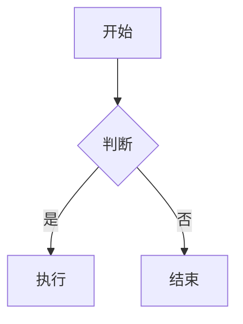
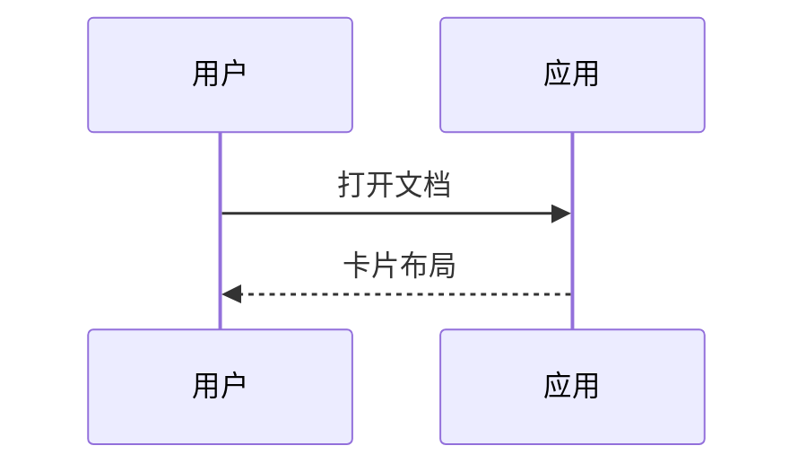

这段文字写在第一个标题**之前**：按 T-055 它应成为一张独立的顶层卡片（类型 fallback_text），而不是被塞进某个外层的「分区卡」里。

# 功能测试用例（mcwr）

这个文件的每个标题就是一条检查项；标题里的括号写的是「应该看到什么」。建议用
「全部还原」之外的默认视图逐节核对，改动后重跑一遍即可当回归用。

[TOC]

## 1 标题层级：H1 → H2 → H3 正常嵌套（子卡嵌在父卡内部，父卡高度随内容）

正文属于本节卡片。

### 1.1 三级标题

正文。

#### 1.1.1 四级标题

层级条应为每级一个色档。

##### 1.1.1.1 五级标题（第 5 级起复用第 4 档颜色）

正文。

###### 1.1.1.1.1 六级标题

正文。

## 2 层级跳变：H2 后直接 H4（应挂到最近的低级标题上，而不是自成一张根卡）

#### 2.1 跳过 H3 的四级标题

正文。

## 3 同名标题（出现两次：两张卡都要在，不能互相吸收内容）

### 3.1 重名示例

第一处的内容。

### 3.1 重名示例

第二处的内容。

## 4 卡内文本格式（粗体、斜体、行内代码、链接、引用、列表、HTML 注释都应在同一张卡的正文里）

一个段落，含 **粗体**、*斜体*、`行内代码`、[外部链接](https://example.com)，
以及中文标点：，。；、！？——破折号，和 emoji 🎴🧩。

> 引用块：应作为本卡正文的一部分渲染。

- 无序列表项一
- 无序列表项二
  - 嵌套项

1. 有序列表项一
2. 有序列表项二

<!-- HTML 注释块：属于正文，不应变成独立卡片 -->

## 5 任务列表卡片（勾选框各自独立）

- [ ] 未完成任务
- [x] 已完成任务
- [ ] 含 `行内代码` 与 [链接](https://example.com) 的任务

## 6 代码卡片

```python
def greet(name: str) -> str:
    """短代码块：卡片底部不应留多余空白（E-029）。"""
    return f"hello {name}"
```

### 6.1 无语言标注的代码块（仍应识别为代码卡）

```
plain fence without a language
second line
```

### 6.2 长代码块（35 行：必须完整显示，不裁行、不留白）

```python
import math


class Grid:
    """A tiny grid used only to make this block long."""

    def __init__(self, rows: int, cols: int) -> None:
        self.rows = rows
        self.cols = cols
        self.cells = [[0 for _ in range(cols)] for _ in range(rows)]

    def set(self, row: int, col: int, value: int) -> None:
        self.cells[row][col] = value

    def get(self, row: int, col: int) -> int:
        return self.cells[row][col]

    def row_sum(self, row: int) -> int:
        return sum(self.cells[row])

    def col_sum(self, col: int) -> int:
        return sum(self.cells[row][col] for row in range(self.rows))

    def diagonal(self) -> list[int]:
        size = min(self.rows, self.cols)
        return [self.cells[index][index] for index in range(size)]

    def scaled(self, factor: float) -> list[list[float]]:
        return [[cell * factor for cell in row] for row in self.cells]

    def norm(self) -> float:
        return math.sqrt(sum(cell * cell for row in self.cells for cell in row))
```

### 6.3 超长单行（不应撑破卡片宽度，应换行或横向裁切）

```text
THIS_IS_ONE_EXTREMELY_LONG_LINE_WITHOUT_ANY_SPACES_OR_BREAK_OPPORTUNITIES_AT_ALL_0123456789ABCDEFGHIJKLMNOPQRSTUVWXYZ_AND_IT_KEEPS_GOING_AND_GOING
```

## 7 表格卡片

### 7.1 短表格

| 列 A | 列 B | 列 C |
| --- | --- | --- |
| 1 | 2 | 3 |

### 7.2 长表格（25 行：每一行都必须显示，不能只显示前几行）

| 序号 | 名称 | 数值 | 备注 |
| --- | --- | --- | --- |
| 1 | alpha | 0.10 | 第一行 |
| 2 | bravo | 0.20 | |
| 3 | charlie | 0.30 | |
| 4 | delta | 0.40 | |
| 5 | echo | 0.50 | |
| 6 | foxtrot | 0.60 | |
| 7 | golf | 0.70 | |
| 8 | hotel | 0.80 | |
| 9 | india | 0.90 | |
| 10 | juliett | 1.00 | |
| 11 | kilo | 1.10 | |
| 12 | lima | 1.20 | |
| 13 | mike | 1.30 | |
| 14 | november | 1.40 | |
| 15 | oscar | 1.50 | |
| 16 | papa | 1.60 | |
| 17 | quebec | 1.70 | |
| 18 | romeo | 1.80 | 中文与 emoji 🎯 |
| 19 | sierra | 1.90 | |
| 20 | tango | 2.00 | |
| 21 | uniform | 2.10 | |
| 22 | victor | 2.20 | |
| 23 | whiskey | 2.30 | |
| 24 | xray | 2.40 | |
| 25 | zulu | 2.50 | 最后一行必须可见 |

### 7.3 含转义竖线与行内代码的单元格

| 表达式 | 说明 |
| --- | --- |
| `a \| b` | 转义竖线 |
| `x = 1` | 行内代码 |
| 中文与 `code` | 混排 |

## 8 数学公式

### 8.1 块级公式（应渲染成图片卡片）

$$
E = mc^2
$$

### 8.2 另一个块级公式

$$
\int_0^1 x^2 \, dx = \frac{1}{3}
$$

### 8.3 行内公式（属于本卡正文，不单独成卡）

质能方程 $E = mc^2$ 出现在正文里，与中文混排。

## 9 Mermaid 图表

### 9.1 简单流程图（应渲染成图片卡片）



### 9.2 稍复杂的图



## 10 目录卡与卡片间跳转

[[TOC]]

检查：目录卡列出全文标题；点任意条目应跳到对应卡片并高亮；目标卡被折叠时祖先逐级展开；
点链接**不会**拖动卡片；目录卡本身可折叠/拖出。

## 11 分隔线（`---` 只分隔块，不产生卡片；连续分隔线不产生空卡）

分隔线上方的正文。

---

分隔线下方的正文（应与上方同属本节卡片）。

---

---

连续分隔线之后仍然属于本节卡片。

## 12 空内容与极短卡片（卡片高度应贴合内容，不留大片空白）

### 12.1 标题下没有正文

### 12.2 只有一行正文

就一行。

### 12.3 只有空白的正文

&nbsp;

## 13 图片（文件不存在时应显示替代文字/占位，不应崩溃）


## 14 卡片数量与滚动（20 张小卡：滚动、平移、懒渲染应流畅）

### 14.1 小卡

一行正文。

### 14.2 小卡

一行正文。

### 14.3 小卡

一行正文。

### 14.4 小卡

一行正文。

### 14.5 小卡

一行正文。

### 14.6 小卡

一行正文。

### 14.7 小卡

一行正文。

### 14.8 小卡

一行正文。

### 14.9 小卡

一行正文。

### 14.10 小卡

一行正文。

### 14.11 小卡

一行正文。

### 14.12 小卡

一行正文。

### 14.13 小卡

一行正文。

### 14.14 小卡

一行正文。

### 14.15 小卡

一行正文。

### 14.16 小卡

一行正文。

### 14.17 小卡

一行正文。

### 14.18 小卡

一行正文。

### 14.19 小卡

一行正文。

### 14.20 小卡

一行正文。

## 15 特殊字符与超长词

含 `|`、`$`、反引号 ` 和反斜杠 \ 的正文；全角标点：，。；、「」【】（）；破折号——省略号……
以及超长不可断词：averyveryverylongsinglewordwithoutanyspacesorhyphensatall_0123456789。

## 16 与布局/交互相关的检查清单（不需要正文，照着做一遍即可）

- 折叠 / 展开：右键父卡折叠 → 子卡隐藏且父卡收缩；展开后子卡位置还原。
- 拖出 / 还原：右键子卡「拖出为自由卡片」→ 拖动 → 再「还原到父卡片」；子卡之间的上下关系与间距应保持不变且不重叠（E-028）。
- 标题栏拖动：按住**标题栏**拖动，移动的是该卡本身，不是它背后的卡片（E-027）。
- 网格吸附：自由卡松手时距格线 ≤12 px 会吸附；工具栏「吸附到网格」可关闭（D-051）。
- 多选整组移动：右键拖出矩形框选多张自由卡 → 左键按住其中一张整体移动；**边缘吸附优先于网格**（D-052）。
- 平移 / 缩放 / 居中：中键拖动平移（任意方向都有余量）、滚轮以光标为锚点缩放、双击卡片居中。
- 刷新 / 全部还原：右下角两个悬浮按钮；改文件后点刷新应保留既有排布（结构性变化除外）。
- 主题与缩放框：工具栏切换浅色/深色/跟随系统，缩放框可选百分比。
- 四边留白：代码、表格、图表元素到卡片四边的距离应一致（6 px，T-053/T-054）。

## 17 回归点速查（对应历史缺陷）

- 长表格每一行都可见（7.2 是 25 行）—— E-029。
- 代码卡底部无多余留白（6、6.1）—— E-029。
- 父卡正文与首个子卡之间约 20 px，不是 56 px —— E-029 / T-050。
- 拖出再还原后，末尾子卡不应停在旧坐标 —— E-028。
- 按标题栏拖动不应拖走背后的卡片 —— E-027。
- 关闭应用再打开：排布与折叠状态应恢复；应用运行中打包会被预检拦住 —— E-025。
- 本文件没有分区卡（没有「Section 1」这类外层卡）—— T-055。
