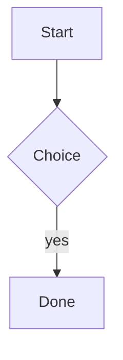

# Spike sample: every block kind the card builder must classify.

Intro paragraph before any heading is common content.

## Task list

- [ ] unchecked item
- [x] checked item

## Table

| Column A | Column B |
| --- | --- |
| 1 | 2 |

## Code

```python
def hello(name: str) -> str:
    return f"hi {name}"
```

## Mermaid



## Math

$$
E = mc^2
$$

Inline math $a^2 + b^2 = c^2$ stays inside its owning card.

## Images


## TOC

[TOC]

### Level jump from H3 (parent is the H2 above)

> A blockquote stays as content of its owning card.

1. ordered item one
2. ordered item two

Raw HTML block:

<div class="note">kept as content</div>

---

## Second big section

Text of the second section.
